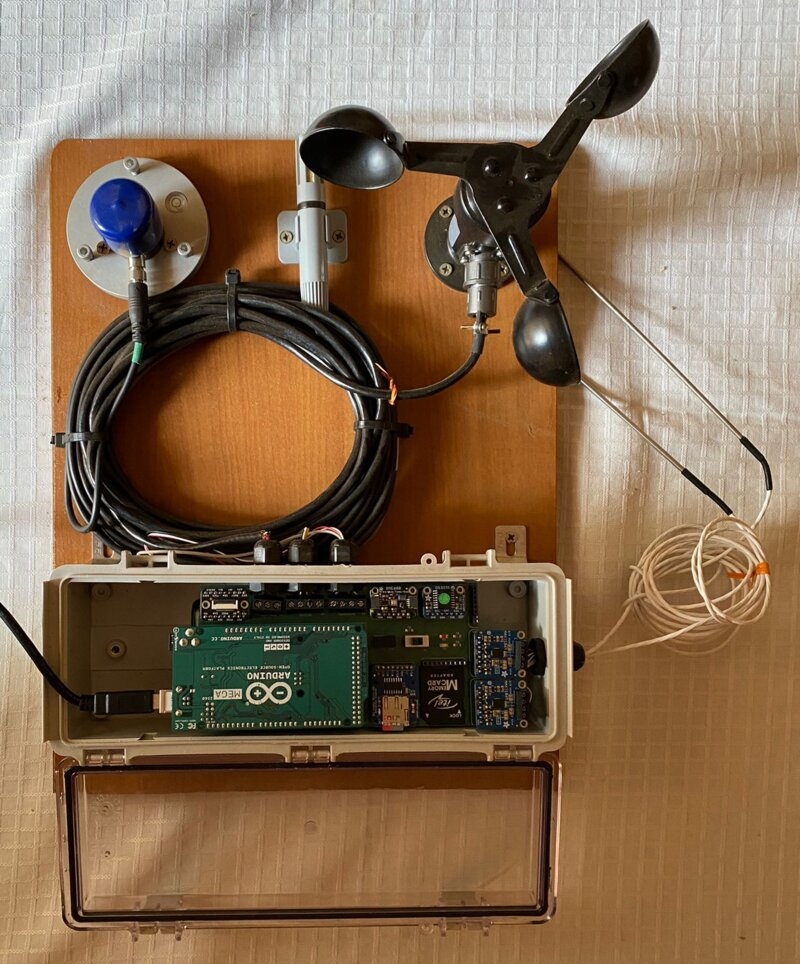

  
   

# Solar Cooker UHasselt

**Solar Cooker UHasselt** is part of the _Solar Cookers for All (SC4All)_ initiative, a collaboration between Hasselt University (Belgium) and the University of Lubumbashi (DRC), funded by VLIR-UOS.  
The project focuses on designing, prototyping, and locally manufacturing low-cost solar cookers for sustainable cooking solutions in resource-constrained communities.

This organization hosts the **source code and PCB designs for the solar cooker testing station in KiCad**, which measures cooking temperature (PT100), ambient conditions (temperature, humidity, wind), and solar irradiance. Key metrics are displayed on an LCD.

Supporting repositories for tools, experiments, and related hardware designs are also included, making this a central hub for the open-source development and testing of solar cooking technologies.

**[Board overview](https://solar-cooker-uhasselt.github.io/)**: every board with its 3D render, linking to its board page with the schematic, board layers and interactive BOM.

## Acknowledgments

This work would not have been possible without the contributions of **Ruben Godde, Kato Warson, and Jonas Meijerink**.

## Contributing

The project is maintained by **Lowie Van Vyve** (head maintainer), reachable at
[solar-cooker@lowie.xyz](mailto:solar-cooker@lowie.xyz).

- To work on the project, ask to be added to the organization. Members join a team for
  the repos they work on, such as electronics or data.
- Changes reach `main` through a pull request, approved by a maintainer. Each
  repository's README describes the steps under Contributing.

## Version 1 Testing Station

  

_Early prototype of the solar cooker testing station (Version 1), used for initial field experiments and validation of sensors and data acquisition._

## Version 2 Testing Station

<table>
  <tr>
    <td align="center">
       
      Top
    </td>
    <td align="center">
       
      Bottom
    </td>
  </tr>
</table>

_Version 2 of the testing station, a shield for the Arduino UNO R4 WiFi. CI renders these
from [kicad-testing-station](https://github.com/solar-cooker-UHasselt/kicad-testing-station)
on every change, the [board page](https://solar-cooker-uhasselt.github.io/kicad-testing-station/)
has the schematic, board layers and interactive BOM._

## Repository Overview

### Main Repositories

- [**kicad-testing-station**](https://github.com/solar-cooker-UHasselt/kicad-testing-station): KiCad PCB for the solar cooker testing station: cooking temperature, weather and solar irradiance.
- [**arduino-code**](https://github.com/solar-cooker-UHasselt/arduino-code): PlatformIO firmware for the testing station: reads the sensors, logs to microSD, shows readings on an LCD.
- [**kicad-ci**](https://github.com/solar-cooker-UHasselt/kicad-ci): Shared KiBot CI for the KiCad board repos: ERC, DRC, board page, BOM and draft releases.
- [**kicad-common**](https://github.com/solar-cooker-UHasselt/kicad-common): Shared KiCad library for the solar cooker boards: symbols, footprints and 3D models.
- [**solar-cooker-uhasselt.github.io**](https://github.com/solar-cooker-UHasselt/solar-cooker-uhasselt.github.io): The [board overview](https://solar-cooker-uhasselt.github.io/) page.

### Breakout Boards on the Testing Station

- [**kicad-adafruit-bme680**](https://github.com/solar-cooker-UHasselt/kicad-adafruit-bme680): KiCad port of the Adafruit BME680 breakout: temperature, humidity, pressure and gas sensor.
- [**kicad-adafruit-ds3231**](https://github.com/solar-cooker-UHasselt/kicad-adafruit-ds3231): KiCad port of the Adafruit DS3231 breakout: precision real-time clock.
- [**kicad-adafruit-max31865**](https://github.com/solar-cooker-UHasselt/kicad-adafruit-max31865): KiCad port of the Adafruit MAX31865 breakout: PT100 RTD temperature amplifier.
- [**kicad-adafruit-microsd**](https://github.com/solar-cooker-UHasselt/kicad-adafruit-microsd): KiCad port of the Adafruit microSD breakout board+: SPI card slot for data logging.

### Old or Supporting Repositories

- [**kicad-arduino-uno-r4-wifi**](https://github.com/solar-cooker-UHasselt/kicad-arduino-uno-r4-wifi): KiCad port of the Arduino UNO R4 WiFi, imported from Altium. Work in progress.
- [**kicad-testing-station-old**](https://github.com/solar-cooker-UHasselt/kicad-testing-station-old): Previous version of the testing station PCB, kept for reference.
- [**shiny-data-analysis**](https://github.com/solar-cooker-UHasselt/shiny-data-analysis): R Shiny app that analyses testing station measurements per ASAE S580.1.
